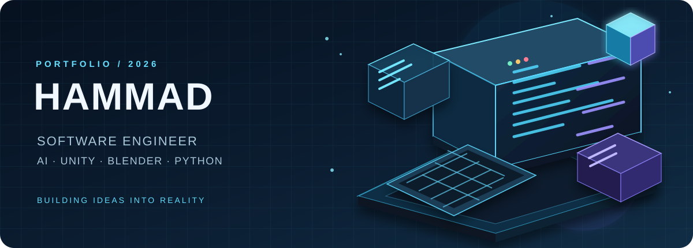
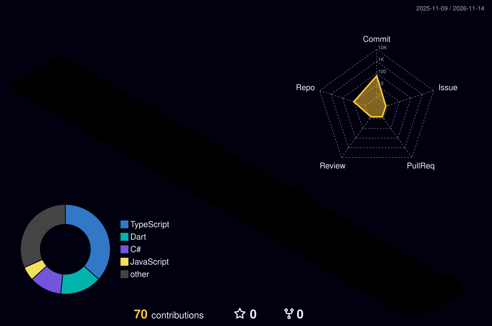

<!--
  Hammad's GitHub Profile README
  Repository name must be exactly: h4mmad07
-->

<div align="center">



<br/>

<a href="https://github.com/h4mmad07">
  
</a>

<br/>

[](https://github.com/h4mmad07)
[](https://www.linkedin.com/in/muhammad-hammad-b812ba294)
[](mailto:mh9456605@gmail.com)
[](https://github.com/h4mmad07)

</div>

---

## ◈ WHO AM I?

I'm **Muhammad Hammad**, a Computer Science undergraduate at **MNS University of Agriculture, Multan, Pakistan**. I enjoy engineering practical software, exploring AI-powered systems, and building interactive 3D experiences.

I work across software development and creative technology — from Python utilities and backend systems to Unity gameplay prototypes and Blender environments. My focus is simple: **learn deeply, build thoughtfully, and make useful things.**

```text
╭──────────────────────────────────────────────────────────────╮
│  ROLE       Software Engineer & AI Enthusiast                 │
│  FOCUS      Software • AI • Game Development • 3D             │
│  TOOLKIT    Python • C++ • C# • SQL • Unity • Blender          │
│  BASE       Multan, Punjab, Pakistan                           │
│  STATUS     Open to internships, entry-level roles & collabs   │
╰──────────────────────────────────────────────────────────────╯
```

## ◈ WHAT I'M BUILDING

<table>
<tr>
<td width="50%" valign="top">

### ⚡ CMailer
**Automated Certificate Generator & Bulk Mailer**

An interactive certificate-design workspace with spreadsheet imports, dynamic text placement, bulk ZIP export, and SMTP email dispatch.

**Stack:** JavaScript · HTML5 Canvas · Node.js · Express

[↗ Explore repository](https://github.com/h4mmad07/CMailer)

</td>
<td width="50%" valign="top">

### 🧹 TidyDrive
**Desktop Storage & Organization Suite**

A storage-management toolkit combining a Windows desktop GUI, automated folder organization, duplicate detection, and a Python CLI engine.

**Stack:** Flutter · Dart · Python

[↗ Explore repository](https://github.com/h4mmad07/TidyDrive)

</td>
</tr>
<tr>
<td width="50%" valign="top">

### 🤖 Hammad AI
**Personal AI Assistant**

Exploring an assistant experience with a Python backend, conversational interface, voice interaction, and local-model fallback.

**Focus:** Python · FastAPI · AI integration

</td>
<td width="50%" valign="top">

### 🇵🇰 Safar-e-Pakistan
**3D Cultural Heritage Game**

A Unity-based educational game concept exploring Pakistan's history through environments, characters, missions, and interactive learning.

**Focus:** Unity · C# · Blender · 3D environments

</td>
</tr>
</table>

<p align="center">
  <a href="https://github.com/h4mmad07?tab=repositories">
    
  </a>
</p>

## ◈ TECHNOLOGY MATRIX

<div align="center">

**LANGUAGES**


**GAME DEVELOPMENT · 3D · DESIGN**


**BACKEND · TOOLS · WORKFLOW**


</div>

## ◈ GITHUB / ACTIVITY

<div align="center">

<a href="https://github.com/h4mmad07">
  
</a>
<a href="https://github.com/h4mmad07">
  
</a>

<br/>


</div>

## ◈ 3D CONTRIBUTION UNIVERSE

<div align="center">

<!-- Generated automatically by .github/workflows/profile-3d.yml -->


</div>

## ◈ CURRENTLY EXPLORING

- Building practical AI assistants and Python backend services.
- Developing gameplay systems and interactive environments with Unity and C#.
- Improving 3D modelling, scene composition, and asset workflows in Blender.
- Strengthening software engineering fundamentals through real projects.

## ◈ LET'S CONNECT

I'm open to **internships, junior software/game development opportunities, and meaningful collaborations**.

<div align="center">

[](https://www.linkedin.com/in/muhammad-hammad-b812ba294)
[](mailto:mh9456605@gmail.com)
[](https://github.com/h4mmad07?tab=repositories)

<br/>


<sub>Designed in a 3D-inspired style · Built with curiosity by **Hammad**</sub>

</div>
