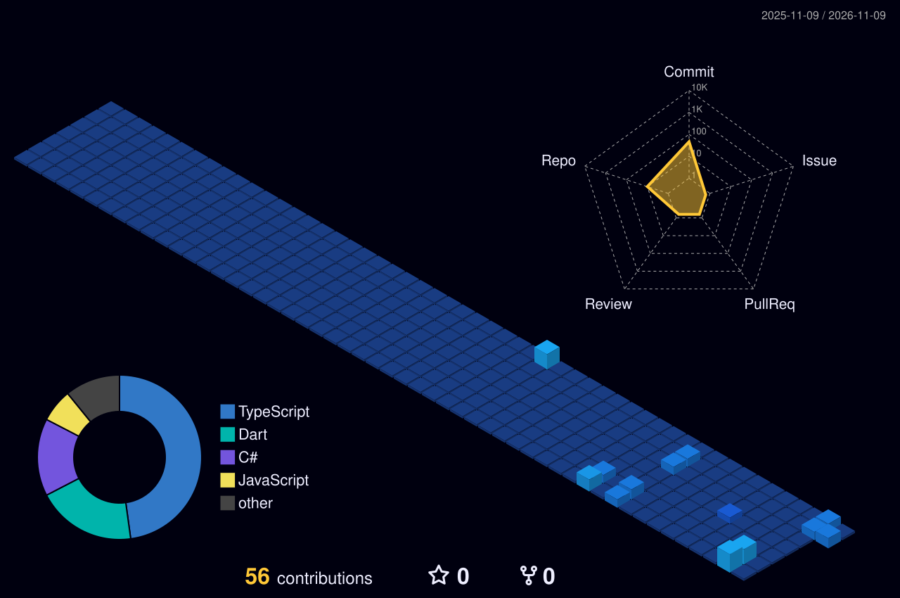

<!-- Repo name MUST be exactly: h4mmad07 (same as your username) -->

<div align="center">


<a href="https://git.io/typing-svg">
  
</a>

<br/>


</div>

---

## `> SYSTEM.BOOT()`

```text
╔══════════════════════════════════════════════════════════╗
║  NAME      : Hammad                                       ║
║  STATUS    : CS Undergraduate @ MNSUAM, Multan            ║
║  LOCATION  : Pakistan                                     ║
║  MISSION   : Practical software that serves communities   ║
║  CORE      : C++ | C# .NET | Python | Flutter | Unity     ║
╚══════════════════════════════════════════════════════════╝
```

## `> TECH_ARSENAL`

<div align="center">


</div>

## `> ACTIVE_PROJECTS`

<table>
<tr>
<td width="50%" valign="top">

### 🗺️ Safar-e-Pakistan
3D educational heritage game exploring Pakistan's culture and landmarks.
**Unity · C#** — Final Year Project

</td>
<td width="50%" valign="top">

### 🤖 Hammad AI (JARVIS Mark VII)
Autonomous Windows desktop assistant and computer-use agent.
**Python · AI Agents**

</td>
</tr>
<tr>
<td width="50%" valign="top">

### 🥛 Milk Hisaab
Offline dairy ledger app for milk sellers across Pakistan.
**Flutter · Dart · SQLite**

</td>
<td width="50%" valign="top">

### 🔋 Battery Guard
Windows tray app that enforces healthy 20–80% battery charging.
**C# · .NET 8 · WinForms**

</td>
</tr>
<tr>
<td width="50%" valign="top">

### 🩺 LHW Family Health Register
Register system for Lady Health Workers (Excel, Access, .NET).
**C# · .NET WinForms · Access**

</td>
<td width="50%" valign="top">

### 📊 BISE Multan Result Scraper
Automation that scrapes results and fills Excel workbooks.
**Python · Excel automation**

</td>
</tr>
</table>

## `> CONTRIBUTION_MATRIX` (3D)

<div align="center">



</div>

## `> STATS_CORE`

<div align="center">


<br/>


</div>

## `> OPEN_CHANNEL`

<div align="center">

[](https://github.com/h4mmad07)
<!-- Add your own links below, then remove the comment markers
[](YOUR_LINKEDIN_URL)
[](mailto:YOUR_EMAIL)
-->


</div>
